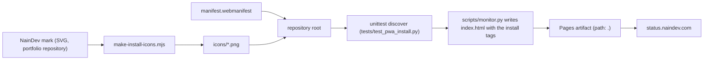

# Implementation plan: Installable status page (Android and iOS)

Status: Implemented on `feat/pwa-install-status`, not merged

## Modules

- **Manifest**: `manifest.webmanifest`, a static file at the repository root, which is the root of the
  published site. Covers INS-001, INS-002, INS-003.
- **Icons**: `icons/icon-192.png`, `icons/icon-512.png`, `icons/icon-maskable-512.png` and
  `icons/apple-touch-icon.png`, rendered once from the NainDev mark and committed. Covers INS-003, INS-004.
- **Head tags**: `build_install_head()` in `scripts/monitor.py`, placed in the head of the page by
  `generate_html_dashboard()`. The committed `index.html` carries the same lines. Covers INS-001, INS-005,
  INS-006.
- **Guard**: `tests/test_pwa_install.py`, collected by the `unittest discover` step of the workflow. Covers
  INS-007.



## Data model changes

None.

## Key decisions

- **Decision**: a static manifest at the repository root, with `./` paths.
  - **Discarded alternative**: a manifest written by `scripts/monitor.py` on every run, or root-absolute paths.
  - **Rationale**: nothing in the manifest changes between runs, the workflow publishes the root as it is, and
    the page is one document that already links its data files relatively.
- **Decision**: the head tags come from the generator, and the committed `index.html` is updated to match.
  - **Discarded alternative**: editing `index.html` alone.
  - **Rationale**: the workflow rewrites and publishes the file on every run; only what the generator writes
    reaches the site.
- **Decision**: the icons derive from the NainDev mark the page already links as favicon
  (`https://www.naindev.com/favicon.ico`; vector source `public/assets/images/favicon-optimized.svg` in
  `Nain9Dev/nain9dev.github.io`).
  - **Discarded alternative**: the letter badge of the page header, which is a CSS gradient box and not a mark,
    or the drawing of the README banners.
  - **Rationale**: the favicon is the only brand mark the site itself shows. The cost is an icon identical to
    the one of the installed portfolio; the label tells them apart.
- **Decision**: the maskable and Apple icons sit on the tile colour of the mark (`#002B66`), and the maskable
  mark is scaled to 0.846.
  - **Discarded alternative**: the default scale of the script (0.56), sized for a mark whose tile must stay
    whole inside the safe zone.
  - **Rationale**: on its own tile colour the tile blends into the background and only the strokes have to
    stay in the safe zone. 0.846 is 0.66 / 0.78, the proportion of the portfolio's maskable icon: the round
    caps end at 36.5% of the width from the centre, inside the 40% circle.
- **Decision**: no service worker.
  - **Discarded alternative**: an offline shell.
  - **Rationale**: Chrome and iOS install without one, and a cache could show an old reading of the services.
    Owner decision of 2026-11-13.
- **Decision**: the status bar style is `black`.
  - **Discarded alternative**: `black-translucent`.
  - **Rationale**: the page is dark, and the translucent style draws the page under the status bar and needs
    safe-area insets the page does not have.
- **Decision**: the test decodes the icons with the standard library (`zlib` and `struct`).
  - **Discarded alternative**: an image library as a test dependency, or a check of the PNG header alone.
  - **Rationale**: the repository has no dependency and the workflow installs none; the header cannot tell
    whether an icon is opaque or where its mark ends.
- **Decision**: the workflow is not edited.
  - **Rationale**: it already uploads the repository root, and its test step collects the new file by name
    pattern.

## Icons

Rendered on 2026-11-13 from the root of this repository:

```
node <tools>/make-install-icons.mjs \
  --source <portfolio>/public/assets/images/favicon-optimized.svg \
  --out icons --bg "#002B66" --maskable-scale 0.846
```

`<tools>` is the folder of the scripts shared by the repositories of this install round, kept outside them;
`<portfolio>` is a checkout of `Nain9Dev/nain9dev.github.io`. The script renders with the `sharp` package of
that checkout, so this repository gains no dependency. What it does, for any other rasteriser:

- `icon-192.png` and `icon-512.png`: the SVG as drawn, rounded tile and transparent corners included.
- `icon-maskable-512.png`: the SVG at 433 px (0.846 of 512) centred on an opaque 512 px square of `#002B66`.
- `apple-touch-icon.png`: the SVG at 180 px on an opaque 180 px square of `#002B66`.

Measured on the committed files: the maskable icon has no transparent pixel, its mark covers 11.3% of the tile
and ends at 36.5% of the width from the centre; the Apple icon has no transparent pixel. Two runs of the
command wrote the same bytes.

## Test strategy

- Contract test with `unittest` and the standard library only: manifest members and exact names, icon files
  (size from the PNG header, opacity and safe zone from the decoded pixels), and the head tags of the page the
  generator writes. Its PNG reader takes 8-bit RGB or RGBA files, which is what the icon script writes. A
  palette, 16-bit or interlaced file makes the test stop with an error instead of passing unchecked.

| Requirement | Test in `tests/test_pwa_install.py` |
| :--- | :--- |
| INS-001 | `TestGeneratedPageInstallTags.test_links_the_published_manifest_once` |
| INS-002 | `TestManifest.test_names_the_app_and_opens_it_standalone_from_the_site_root`, `TestManifest.test_repeats_the_language_description_and_background_of_the_page` |
| INS-003 | `TestManifest.test_declares_192_and_512_px_icons_and_a_maskable_one`, `TestInstallIcons.test_every_declared_icon_is_a_png_of_the_declared_size` |
| INS-004 | `TestInstallIcons.test_maskable_icon_is_opaque_and_keeps_the_mark_in_the_safe_zone`, `TestInstallIcons.test_apple_touch_icon_is_180_px_and_opaque` |
| INS-005 | `TestGeneratedPageInstallTags.test_carries_the_ios_tags`, `TestInstallIcons.test_apple_touch_icon_is_180_px_and_opaque` |
| INS-006 | `TestGeneratedPageInstallTags.test_theme_colour_matches_the_manifest_and_the_page_background` |
| INS-007 | the file matches `test*.py`, the pattern of `python -m unittest discover -s tests` |

- One-off checks, recorded in `tasks.md`: the PNG reader of the test against the pixels `sharp` reads, a
  mutation run that breaks one rule at a time, and `Page.getInstallabilityErrors` in headless Chrome on a copy
  of the published folder.
- Manual: after the deploy, the owner's Android phone and iPhone.
